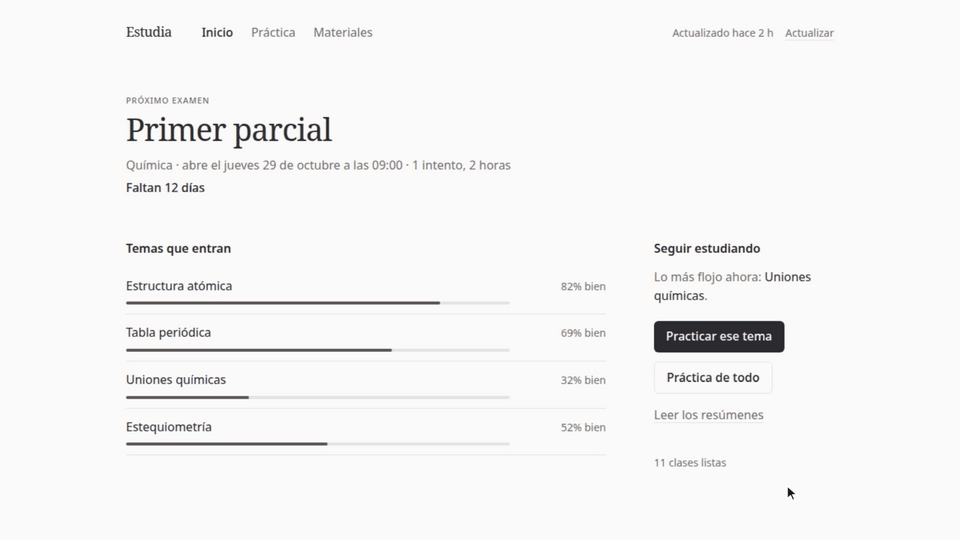
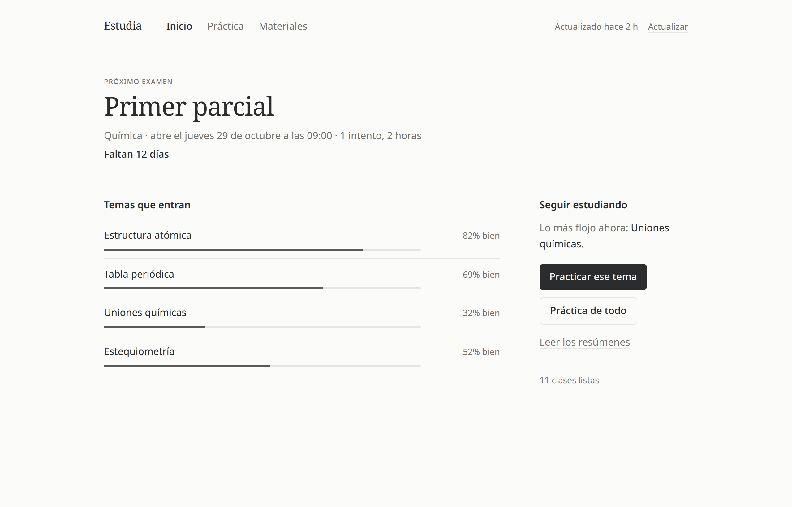
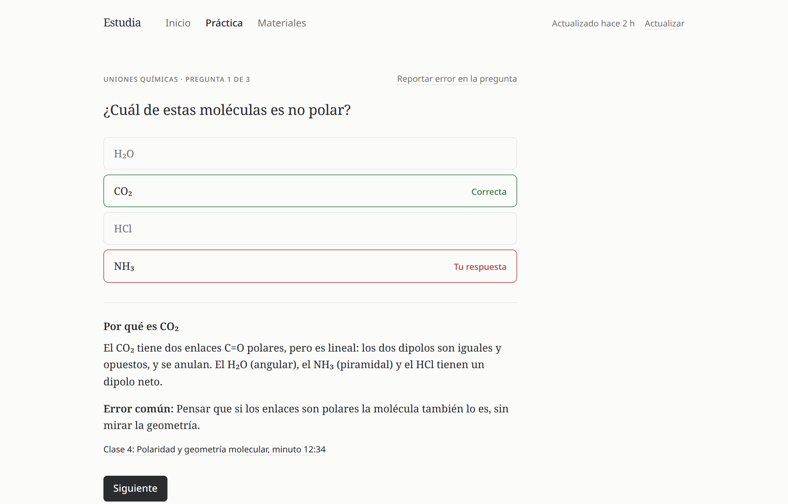

<div align="center">

# Estudia

**Practicá con las clases de tu campus y llegá al examen sabiendo qué te falta.**

Gratis, de código abierto y corre en tu PC. Hecho por un estudiante del ingreso a la UTN.

[](LICENSE)
[](#roadmap)
[](https://www.python.org/)



<sub>Recorrido real por la app, con datos de ejemplo de tres materias.</sub>

</div>

## Por qué

- **Practicás con el material de tu cátedra**, no con ejercicios sueltos de internet. Estudia toma las clases de tu campus Moodle y arma resúmenes y preguntas con corrección al instante.
- **Cuando le errás, te dice por qué y de dónde sale.** Cada respuesta trae la explicación, el error común y el minuto de la clase donde se ve. Lo que fallás vuelve en los días siguientes, y una pregunta cuenta como sabida cuando la acertás en tres días distintos.
- **Sabés si llegás al examen.** Para cada tema ves la probabilidad de que lo sepas el día del parcial, y "¿Llegás?" te dice por qué y qué estudiar hoy.
- **Tu semana, ordenada.** La agenda junta tus horarios de cursada, entregas y exámenes del campus, y un plan reparte sesiones de estudio en el tiempo que le das, sin pisarse con tus clases. Se exporta a Google Calendar o al celular con un archivo `.ics`.
- **Un simulacro antes del parcial.** Mismos temas, reloj y escala de nota que el examen, sin ver las respuestas hasta el final. Antes te pregunta cuánto creés que te sacás, para que veas si te estás sobreestimando.
- **También con apuntes en PDF.** Los PDF y las diapositivas del campus se leen como las clases en video, y cada pregunta te dice de qué apunte y de qué página sale.
- **Simulacro con el formato de tu cátedra.** Cargás tus parciales viejos (PDF o foto) y Estudia copia la cantidad de ejercicios, el tiempo y la escala. Tus parciales quedan en tu compu.
- **Para cada momento de la cursada.** Inscripciones con aviso antes del cierre, recuperatorio que repasa solo lo que no tenés firme, y final con un plan de 6 semanas. Te lo dice sin retar.
- **Practicar como pide la ciencia del aprendizaje.** Te pregunta qué tan seguro estabas (una respuesta adivinada no cuenta como sabida), a veces te pide pensar antes de ver las opciones o escribir el resultado, y antes del parcial mezcla temas para que practiques reconocer qué método va.

## Cómo se ve

<table>
<tr>
<td width="50%">
<picture>
  <source media="(prefers-color-scheme: dark)" srcset="docs/img/inicio-oscuro.png">
  
</picture>
</td>
<td width="50%">
<picture>
  <source media="(prefers-color-scheme: dark)" srcset="docs/img/practica-oscuro.png">
  
</picture>
</td>
</tr>
</table>

Las capturas usan datos de ejemplo. Estudia no incluye material de ninguna cátedra.

## Cómo evita enseñarte algo mal

Una pregunta con la respuesta equivocada es peor que no tener pregunta. Por eso:

1. Las preguntas con cuentas se verifican con código antes de mostrarse.
2. Una segunda pasada de la IA las resuelve sin ver la respuesta. Si no coinciden, la pregunta se descarta.
3. Cada pregunta dice de qué clase y minuto sale.
4. Si igual encontrás una mal, el botón **"Reportar un error"** la saca de tu banco. Y si nos contás cuál era, mejor (ver [Feedback](#feedback)).

## Privacidad, en criollo

- **Todo queda en tu compu.** Tus materias, los resúmenes, las preguntas y tus resultados se guardan en tu PC. No hay servidor de Estudia, no hay cuentas y no hay publicidad.
- **No ve tu contraseña del campus.** Iniciás sesión en la página de tu campus, como siempre, y Estudia recibe un permiso de solo lectura. Ese permiso y tu clave de Gemini se guardan en el almacén seguro de tu sistema (el mismo que usa el navegador para tus contraseñas).
- **Solo lee.** Nunca entrega, responde ni publica nada en tu campus.
- **Lo único que sale de tu PC** es lo que se le manda a Gemini para procesar cada clase. Los videos de YouTube se le pasan por enlace; bajarlos para mandarlos es opcional y viene apagado.
- **Ojo con el plan gratis de Gemini.** Según los [términos de Google](https://ai.google.dev/gemini-api/terms), en el plan gratuito Google puede usar lo que recibe para mejorar sus productos, y puede leerlo una persona. Esos términos también piden **tener 18 años o más**: por eso Estudia te pregunta la edad, y si tenés menos usa la agenda, el plan y la práctica sin mandar nada a Gemini. Si te importa la privacidad, usá una clave paga: ahí Google no usa tus datos para entrenar.
- **El material es de tu cátedra.** Estudia lo procesa solo para vos, con tu usuario. No lo publica, no lo comparte y no lo redistribuye. Por favor, no subas material de clases a los issues.

## Dónde funciona

Estudia se conecta a campus Moodle que tengan activo el servicio para celulares, el mismo que usa la app oficial de Moodle. Hoy anda de punta a punta con un solo campus; el resto ya está relevado y llega en la [etapa 5](#roadmap).

**UTN**

| Regional | Campus | Estado |
|---|---|---|
| Buenos Aires (FRBA) | aulasvirtuales.frba.utn.edu.ar | **Funciona hoy** |
| Córdoba | uv.frc.utn.edu.ar | Compatible, en camino |
| Rosario | moodle.frro.utn.edu.ar, frro.cvg.utn.edu.ar | Compatible, en camino |
| La Plata | frlp.cvg.utn.edu.ar | Compatible, en camino |
| Haedo | frh.cvg.utn.edu.ar | Compatible, en camino (login con Office 365) |
| Avellaneda | www.utnfravirtual.org.ar | Compatible, en camino |
| General Pacheco | frgp.cvg.utn.edu.ar | Compatible, en camino |
| Delta | frd.cvg.utn.edu.ar | Compatible, en camino |
| Santa Fe | campusvirtual.frsf.utn.edu.ar | Compatible, en camino |
| Tucumán | frt.cvg.utn.edu.ar | Compatible, en camino |
| Mendoza | campusvirtual.frm.utn.edu.ar | No por ahora: tiene apagado el servicio para celulares |

**UBA**

| Unidad | Campus | Estado |
|---|---|---|
| CBC | cbccampusvirtual.uba.ar | Compatible, en camino |
| UBA XXI | www.ubaxxicampusvirtual.uba.ar | Compatible, en camino (login con Microsoft 365) |
| Exactas | campus.exactas.uba.ar | Compatible, en camino (login con idEx) |
| Medicina | campus.fmed.uba.ar | Compatible, en camino |
| Sociales | campus.sociales.uba.ar | Compatible, en camino |
| Filosofía y Letras | campus.filo.uba.ar | Compatible, en camino |
| Agronomía | campus.agro.uba.ar | Compatible, en camino |
| Veterinaria | dogo.fvet.uba.ar | Compatible, en camino |
| Farmacia y Bioquímica | campus.ffyb.uba.ar | Compatible, en camino |
| Arquitectura (FADU) | campus.fadu.uba.ar | No por ahora: servicio para celulares apagado |
| Económicas | Moodle detrás de Office 365 | Sin verificar |
| Ingeniería (FIUBA) | campus.fi.uba.ar | No: el campus no es Moodle |
| Derecho | campus propio | No: el campus no es Moodle |
| Psicología, Odontología | — | Sin verificar |

"Compatible" quiere decir que el campus tiene el servicio activo; falta sumarlo al catálogo y probarlo. Si tu facultad no está, podés [sumarla vos](#sumá-tu-facultad).

## Instalación

**Necesitás:**

- una cuenta en el campus de **UTN-FRBA** (las demás facultades llegan en la etapa 5);
- una clave gratis de Gemini, que se saca en [Google AI Studio](https://aistudio.google.com/apikey) (la app te guía).

### Instalar en Windows

1. Bajá `EstudiaSetup-<versión>.exe` de la [última versión](https://github.com/JimmyAlter/estudia/releases/latest), en la lista de archivos (Assets).
2. Abrilo con doble clic y seguí los pasos. No pide permisos de administrador: se instala solo para tu usuario.
3. Al terminar se abre Estudia. Después la encontrás en el menú Inicio.

**Si aparece "Windows protegió su PC":** es el filtro SmartScreen. Tocá **Más información** y después **Ejecutar de todas formas**. Sale porque el instalador no está firmado con un certificado de pago, no porque haya algo raro: el código es abierto, lo podés revisar en este repo, y el instalador lo arma GitHub a partir de ese código. Es probable que el aviso aparezca durante las primeras semanas de cada versión, hasta que Windows la vea en más computadoras.

- **Actualizar:** bajá el instalador nuevo y abrilo. Tus materias y tu progreso se mantienen. Cuando hay una versión nueva, Estudia te avisa.
- **Desinstalar:** desde Configuración → Aplicaciones → Estudia. Te pregunta si querés borrar también tus datos de estudio; si decís que no, quedan por si la volvés a instalar.

### Desde el código (avanzado)

Para macOS y Linux, o si querés tocar el código. Son cinco comandos y no hace falta saber programar, pero sí usar una terminal. Además de lo de arriba necesitás:

- [uv](https://docs.astral.sh/uv/), que instala Python solo;
- [Node.js](https://nodejs.org/) 22 o más nuevo, para armar la interfaz una vez;
- git.

#### 1. Instalá uv, Node y git

**Windows** (PowerShell):

```powershell
winget install --id=astral-sh.uv -e
winget install --id=OpenJS.NodeJS.LTS -e
winget install --id=Git.Git -e
```

**macOS** (con [Homebrew](https://brew.sh/)):

```bash
brew install uv node git
```

**Linux:**

```bash
curl -LsSf https://astral.sh/uv/install.sh | sh
# Node y git, con el gestor de paquetes de tu distribución
```

Cerrá y volvé a abrir la terminal para que tome los comandos nuevos.

#### 2. Bajá Estudia y armá la interfaz

```bash
git clone https://github.com/JimmyAlter/estudia.git
cd estudia
uv sync
cd web && npm ci && npm run build && cd ..
```

#### 3. Abrila

```bash
uv run python -m estudia
```

#### Actualizar y desinstalar

- **Actualizar:** `git pull`, después `uv sync` y `cd web && npm ci && npm run build`.
- **Desinstalar:** en Windows, primero `uv run python -m estudia.server.handler --uninstall` para soltar el enlace de vuelta del login. Después borrá la carpeta `estudia` y la de datos:
  - Windows: `%LOCALAPPDATA%\estudia`
  - macOS: `~/Library/Application Support/estudia`
  - Linux: `~/.local/share/estudia` y `~/.local/share/applications/estudia-handler.desktop`

  El permiso del campus y la clave de Gemini quedan en el almacén seguro del sistema con el nombre `estudia`; los podés borrar desde ahí.

### Primeros pasos

Estudia se abre en tu navegador, en una página de tu propia PC (`127.0.0.1`). Elegís tu facultad, iniciás sesión en el campus y pegás tu clave de Gemini. Después procesa las clases de a una y te avisa cuando hay preguntas.

**Sobre el inicio de sesión:** al terminar el login, el campus te manda de vuelta con un enlace que empieza con `moodlemobile://`.

- **En Windows y Linux** Estudia lo registra y el login vuelve solo, sin que hagas nada. La excepción es Windows desde el código con la app de Moodle ya instalada: ahí Estudia no le saca el enlace a esa app (el instalador sí, y lo devuelve al desinstalar).
- **En macOS** todavía no. Ahí, o si por algo no vuelve solo, la pantalla de Estudia te deja pegar el enlace. En Chrome o Edge lo encontrás así: antes de iniciar sesión apretá F12 y abrí la pestaña **Consola**; al terminar aparece un aviso con la dirección `moodlemobile://token=…`. Copiala desde `moodlemobile://` hasta el final. Ese enlace es tu acceso: no se lo pases a nadie.

**Sobre el plan gratis de Gemini:** tiene un límite por día. Si se termina, Estudia lo dice y sigue con las clases que faltan al día siguiente.

### ¿Querés verla sin campus?

Desde el código, con datos de ejemplo y sin tocar internet ni tus datos:

```bash
uv run python scripts/dev_seed.py --port 8780
```

y abrí `http://127.0.0.1:8780/`.

## Sumá tu facultad

Es la mejor primera contribución y **no hace falta programar**: el catálogo de campus es un archivo de datos, [`src/estudia/catalog/facultades.json`](src/estudia/catalog/facultades.json).

1. Fijate si tu campus sirve. Abrí esta dirección cambiando `<tu-campus>`:

   ```
   https://<tu-campus>/lib/ajax/service-nologin.php?args=[{"index":0,"methodname":"tool_mobile_get_public_config","args":{}}]
   ```

   Si ves `"enablewebservices":1` y `"enablemobilewebservice":1`, sirve. `"typeoflogin"` dice cómo se entra: `1` es usuario y contraseña, `2` es por navegador y `3` es embebido.

2. Sumá una entrada:

   ```json
   {
     "id": "uba-cbc",
     "name": "UBA · Ciclo Básico Común",
     "university": "UBA",
     "url": "https://cbccampusvirtual.uba.ar",
     "login": "password"
   }
   ```

   `login` va `"password"`, `"browser"` o `"embedded"`, según el `typeoflogin` del paso 1.

3. Mandá el pull request contando qué viste en el paso 1 y si pudiste iniciar sesión.

Hoy el único login probado de punta a punta es `"browser"`. Las entradas nuevas igual sirven: con ellas probamos la etapa 5. Si no usás git, abrí un issue de [**"Mi facultad no funciona"**](https://github.com/JimmyAlter/estudia/issues/new?template=facultad-no-funciona.yml) con la dirección del campus y lo sumamos nosotros. Más detalles en [CONTRIBUTING.md](CONTRIBUTING.md).

## Roadmap

- [x] **Etapa 1:** camino UTN-FRBA de punta a punta. Login por navegador, clases en video procesadas con Gemini, preguntas verificadas, práctica con repaso de errores, inicio centrado en el próximo examen y resúmenes.
- [x] **Etapa 2:** agenda con horarios, entregas y exámenes (también cargados a mano), plan de estudio con "¿Llegás?", simulacro con el reloj y la escala del examen real, repaso espaciado por pregunta, confianza y respuestas escritas, exportar a calendario (`.ics`) y a Anki, y recordatorios en la PC.
- [x] **Etapa 3a:** cola por fecha de examen y cuota de Gemini mejor aprovechada, 3 preguntas para arrancar, recuerdo libre, "Explicá por qué", "Cómo vengo", mazo de la semana y calendario del campus en el celular, inscripciones, recuperatorio y final.
- [x] **Etapa 3b:** PDF y diapositivas del campus (con la cita "Apunte 3, pág. 14"), y simulacro con el formato de tu cátedra a partir de tus parciales viejos.
- [ ] **Etapa 3c:** probar con una materia de ejemplo sin campus ni clave, asistente para la clave de Gemini y variantes numéricas de las preguntas.
- [ ] **Etapa 4:** Claude y ChatGPT además de Gemini, videos subidos a Moodle y PDFs.
- [ ] **Etapa 5:** catálogo completo (todas las facultades de la tabla), login con usuario y contraseña y con Office 365, y materias sin cuentas con respuestas verificadas contra una cita del material.
- [x] **Etapa 6:** instalador para Windows, enlace de vuelta del login registrado solo y actualizaciones por GitHub Releases.

El orden puede cambiar según lo que pidan en [Ideas](https://github.com/JimmyAlter/estudia/discussions/categories/ideas).

## Feedback

Esto se hace entre estudiantes, así que lo que digas cambia lo que se construye.

- **Una pregunta con la respuesta mal:** tocá "Reportar un error" en la app y, si podés, abrí un issue de [**"Pregunta incorrecta"**](https://github.com/JimmyAlter/estudia/issues/new?template=pregunta-incorrecta.yml). Contala con tus palabras, sin pegar material de la cátedra. Es el error que más nos importa.
- **Tu facultad no anda o no está:** issue de [**"Mi facultad no funciona"**](https://github.com/JimmyAlter/estudia/issues/new?template=facultad-no-funciona.yml).
- **Una idea o algo que te falta:** issue de [**"Idea"**](https://github.com/JimmyAlter/estudia/issues/new?template=idea.yml) o [Discussions](https://github.com/JimmyAlter/estudia/discussions). Votá con un pulgar las que ya están.
- **Preguntas, dudas de uso o charla:** [Discussions](https://github.com/JimmyAlter/estudia/discussions). Para todo lo demás, [abrí un issue](https://github.com/JimmyAlter/estudia/issues/new/choose).
- **Un problema de seguridad:** en privado, con el [reporte privado de vulnerabilidades](https://github.com/JimmyAlter/estudia/security/advisories/new) de GitHub, como dice [SECURITY.md](SECURITY.md). Nunca en un issue público.

Si Estudia te sirve, o te sirve la idea, dejale una estrella al repo. Nos ayuda a medir cuántos la esperan y a decidir qué facultad sumar primero.

## Preguntas frecuentes

**¿Es oficial de la UTN o de la UBA?** No. Es un proyecto independiente, hecho por estudiantes, sin relación con ninguna universidad.

**¿Cuánto cuesta?** Nada. La IA también es gratis con el plan gratuito de Gemini. Si usás una clave paga, pagás lo que cobre Google.

**¿Hace los cuestionarios por mí?** No. Solo lee el campus. No responde, no entrega y no toca nada.

**¿Anda en el celular?** No. Es para PC, porque procesar las clases necesita la compu prendida un rato.

**¿Por qué Gemini?** Porque tiene un plan gratis y puede mirar los videos de YouTube directamente, que es como viene el material de muchas cátedras. Claude y ChatGPT llegan en la etapa 4.

## Licencia

[MIT](LICENSE). Estudia no incluye ni distribuye material de ninguna cátedra. Los nombres UTN y UBA pertenecen a sus universidades y se usan solo para indicar con qué campus funciona.
